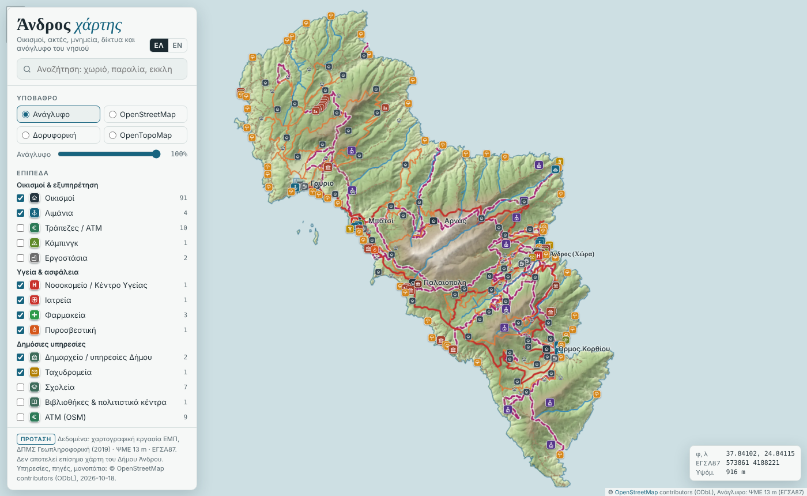
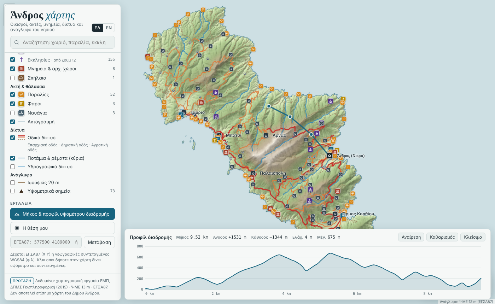

# Andros web map

An interactive map of Andros, the northernmost of the Cyclades, built as **one self-contained HTML file** (Leaflet), with no map server or database.

It started as a 2019 cartography project for the MSc in Geoinformatics at the National Technical University of Athens (NTUA). The project produced printed maps at 1:150,000 and a GeoServer/OpenLayers web map. This repository rebuilds the web version with Python. The aim is a map that is cheap enough for a small island municipality to host and maintain.



## What it does

- **Relief basemap** from a 13 m DTM and hillshade (hypsometric tint × hillshade), so the map works with no tile service.
- **Settlements, beaches, churches and monasteries, monuments, ports, lighthouses, wrecks, roads by class, rivers, 20 m contours and spot heights**, each with its own map symbol.
- **Search** across villages, beaches, churches and rivers. It ignores Greek accents and works in Greek or English.
- **Click anywhere** for elevation and coordinates in WGS84 and Greek Grid (ΕΓΣΑ87 / EPSG:2100), with a directions link.
- **Go to coordinates** in ΕΓΣΑ87 X Y or latitude/longitude.
- **Route length and elevation profile**: draw a line and get distance, total ascent and descent, and min/max elevation. Each waymarked trail (when OSM data is included) opens its own profile in one click.
- **Optional OpenStreetMap layers**: health services, pharmacies, police, fire service, municipal offices, post, schools, fuel, bus stops, springs and fountains, viewpoints, museums, archaeological sites and waymarked trails.
- Greek and English interface, light and dark themes, and a layout that works on phones.



## Build

```bash
pip install -r requirements.txt

# optional: download open OpenStreetMap data for the island (needs internet)
python fetch_osm.py                      # writes osm_andros.json

python build.py --data data --osm osm_andros.json --out index.html
```

### If `fetch_osm.py` keeps failing

The public Overpass servers are sometimes overloaded. You can download the same data in a browser instead:

1. Open <https://overpass-turbo.eu>.
2. Paste each query from `PARTS` in `fetch_osm.py` (one at a time) and press **Run**.
3. Choose **Export → raw OSM data** and save the file.
4. Send the saved files over to be merged, or run the script again later.

`build.py` expects the original project data in `data/`:

```
data/scale50000/scale50000/*.shp     1:50,000 layers (ΕΓΣΑ87)
data/scale150000/scale150000/*.shp   1:150,000 generalised layers (main-village set)
data/raster/raster/dtm_androstif1.tif, HillSha_tif11.tif
```

The build:
1. reprojects the vector layers to WGS84 and simplifies them;
2. renders the relief and warps it to Web Mercator (WebP, about 3 MB);
3. resamples the DTM into a compact elevation grid (about 40 m) that the page uses for click elevations and profiles;
4. injects everything into `template.html`, which produces `index.html`.

## Hosting

`index.html` is the whole map. Put it on any web server, or embed it in a page:

```html
<iframe src="https://etymo.co.uk/AndrosWebMap/" style="width:100%;height:80vh;border:0" title="Andros map"></iframe>
```

The online basemaps (OpenStreetMap, satellite, OpenTopoMap) and "My location" need the page to be served over https.

## Data and licences

- **Code**: MIT, see `LICENSE`.
- **Base vector layers** (1:50k / 1:150k): from the Andros teaching dataset used on the NTUA MSc in Geoinformatics. The ArcGIS processing history in each layer shows it was digitised and compiled between 2008 and 2012, before this project. It was used for the 2019 course *Επεξεργασία, Ανάλυση και Απόδοση Χωρικών Δεδομένων*. The raw data is **not** included in this repository.
- **Added by the author (2019)**: the banks layer, the generalisation to 1:150,000, and the cartographic design and symbology. *[Add the DTM and hillshade here if you produced them.]*
- **OpenStreetMap layers**: © OpenStreetMap contributors, available under the [Open Database Licence](https://www.openstreetmap.org/copyright).
- This map is not an official map of the Municipality of Andros.

## Feature categories

The original ArcGIS project kept categories as integer codes, with their meanings defined in the project's symbology and GeoServer SLD styles rather than in the shapefiles. The build decodes them as:

- **Roads** (`Eίδος`): 1 = national road (εθνική οδός), 2 = provincial road (επαρχιακή οδός), 3 = rural road (αγροτική οδός). From `roads.sld`.
- **Religious buildings** (`Type`): 1 = monastery, 2 = church.
- **Monuments** (`Είδος` 1/2/3): shown as one category, because none of the included style files define the subtypes.

---

Built by [@ET](https://etymo.co.uk) · Eriola Trungu Impersimi
